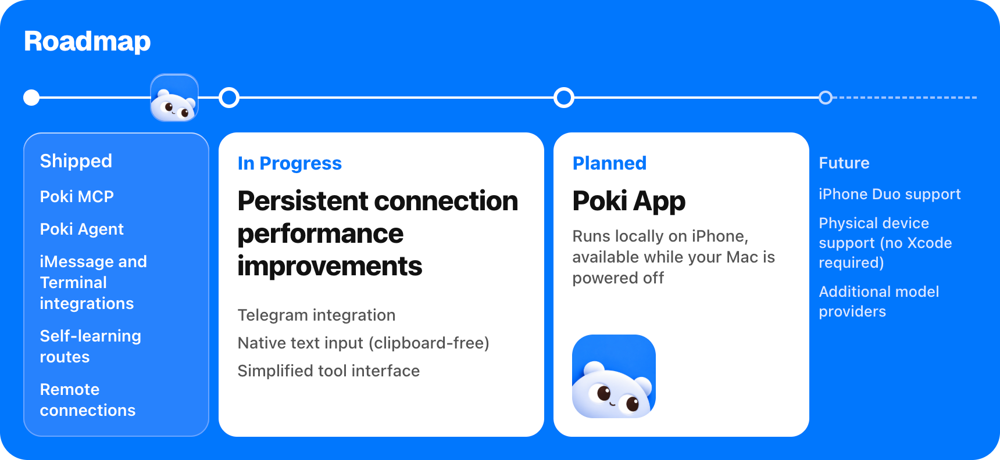

<p align="center">
  
</p>

<h1 align="center">Poki usa tu iPhone como lo harías tú</h1>

<p align="center">
  
</p>

<p align="center">
  <a href="README.poki.md">English</a> | <a href="README.zh-CN.md">简体中文</a> | <a href="README.zh-TW.md">繁體中文</a> | <a href="README.ja.md">日本語</a> | <a href="README.ko.md">한국어</a> | Español<br>
  <a href="https://poki.bot">poki.bot</a>
</p>

<!-- badges:start -->
<p align="center">
  <a href="LICENSE"></a>
  <a href="https://github.com/JosssphZhou/poki/stargazers"></a>
  <a href="https://github.com/JosssphZhou/poki/forks"></a>
  <a href="https://github.com/JosssphZhou/poki/issues"></a>
  <a href="https://github.com/JosssphZhou/poki/releases"></a>
  
</p>
<!-- badges:end -->

## Inicio rápido

**Deja que tu agente lo instale.** Copia esto a tu agente:

```text
Instala https://github.com/JosssphZhou/poki siguiendo el AGENTS.md de la raíz, incluida la skill de MCP, y detente cada vez que necesites que yo haga algo.
```

**Poki MCP.** ¿Ya usas Claude Code, Codex u otro cliente MCP? Conecta Poki MCP y usa tu propia suscripción. No necesitas otra cuenta de modelos.

Inicia el servidor y déjalo en ejecución:

```sh
git clone https://github.com/JosssphZhou/poki.git
cd poki
./bin/setup
npm start
```

Requiere macOS 15 o posterior, Xcode completo, Rust, Node.js 24+ y ffmpeg. `./bin/setup` comprueba qué dependencias faltan. La primera compilación tarda unos minutos.

### Paquete precompilado para macOS arm64

Descarga `poki-v0.1.1-macos-arm64.tar.gz` desde la release y ejecuta:

```sh
tar -xzf poki-v0.1.1-macos-arm64.tar.gz
cd poki-v0.1.1
npm ci --no-audit --no-fund
npm start
```

El paquete incluye el puente nativo y las herramientas de idevice. No necesitas Rust ni `./bin/setup`. Sigues necesitando macOS en Apple Silicon, Xcode completo, Node.js 24+, Python 3 y ffmpeg. Registra tu cliente MCP e instala el Agent opcional como se describe más abajo.

En otra terminal, desde el mismo directorio, registra el servidor MCP:

```sh
claude mcp add --scope user poki-mcp -- node "$PWD/src/stdio.mjs"   # Claude Code
codex mcp add poki-mcp -- node "$PWD/src/stdio.mjs"                 # Codex
```

**Poki Agent.** Para usar el agente de terminal independiente de Poki o sus canales de mensajería, deja `npm start` en ejecución y abre otra terminal en el mismo directorio. Instala el agente, añade su comando al PATH de esta terminal e inicia sesión:

```sh
npm ci --prefix agent
export PATH="$PWD/bin:$PATH"
poki login
poki status
```

Poki Agent usa GPT-6.1 Terra (`gpt-6.1-terra`) con razonamiento low de forma predeterminada. Recomendamos mantener esta configuración: es la más rápida que hemos probado para tareas en el teléfono. Puedes cambiar el modelo con `POKI_AGENT_MODEL`; consulta [Ejecutar Poki Agent](agent/README.md).

Para un iPhone físico, primero emparéjalo con tu Mac por USB. Consulta [Configuración del iPhone físico](docs/physical-iphone.md).

## Prueba una tarea

Con Poki Agent, si hay un solo iPhone conectado, se selecciona automáticamente. Con varios dispositivos, añade `--device '<device UUID>'`.

```sh
node bin/call.mjs list_devices   # Busca el UUID de tu dispositivo
poki "Search esp32 in Chrome and summarize the top result"
```

> **Nota:** Poki controla tu iPhone real. Si le pides que envíe mensajes o haga pagos, lo hará. El contenido de la pantalla se envía al servicio de modelos que hayas configurado.

Cada vez más rápido: Poki Agent recuerda las tareas anteriores y las ejecuta más rápido al repetirlas.

**Canales:** Tras configurar un canal autorizado, inícialo con `poki imessage` o `poki telegram`. Consulta [Poki Agent](agent/README.md) para la configuración.

**Clientes MCP:** Claude Code, Codex y cualquier cliente compatible con JSON de `mcpServers`.

La compatibilidad con iPhone físico solo se ha verificado en iPhone con la interfaz en chino. Los dispositivos físicos solo admiten orientación vertical. No están disponibles la exportación de contenedores de apps ni los enlaces directos a subpáginas de Ajustes. Consulta [verificación y límites conocidos](docs/verification.md).

## Documentación

| Tema | Leer |
| --- | --- |
| Instalación, otros clientes MCP y solución de problemas | [Guía de instalación](docs/install.md) |
| Poki Agent, modelos, iMessage y Telegram | [Ejecutar Poki Agent](agent/README.md) |
| Referencia de herramientas MCP | [Comportamiento de las herramientas](docs/tools.md) |
| Variables de entorno y sesiones | [Configuración](docs/configuration.md) |
| Emparejamiento USB, modo de desarrollador y Wi-Fi | [Configuración del iPhone físico](docs/physical-iphone.md) |
| Resultados de pruebas, límites conocidos y avisos legales | [Verificación](docs/verification.md) |
| Arquitectura del puente | [Puente nativo](native/NATIVE.md) y [adaptador del simulador](native/simulator.md) |
| Hoja de ruta | [poki.bot](https://poki.bot) |

## Hoja de ruta

<p align="center">
  
</p>

- **Publicado:** Poki MCP, Poki Agent, integraciones con iMessage y la terminal, rutas de autoaprendizaje
- **En desarrollo:** **Conexión remota (sin LAN compartida)**, integración con Telegram, entrada de texto nativa (sin portapapeles), mejoras de rendimiento en conexiones persistentes, interfaz de herramientas simplificada
- **Planificado:** Poki App: ejecución local en el iPhone, disponible con el Mac apagado
- **Futuro:** Compatibilidad con iPhone Duo, compatibilidad con dispositivos físicos (sin Xcode), más proveedores de modelos

## Star History

<a href="https://www.star-history.com/?repos=JosssphZhou%2Fpoki&type=date&legend=top-left">
  <picture>
    <source media="(prefers-color-scheme: dark)" srcset="https://api.star-history.com/chart?repos=JosssphZhou/poki&type=date&theme=dark&legend=top-left">
    <source media="(prefers-color-scheme: light)" srcset="https://api.star-history.com/chart?repos=JosssphZhou/poki&type=date&legend=top-left">
    
  </picture>
</a>

## Colaboradores

<a href="https://github.com/JosssphZhou/poki/graphs/contributors">
  
</a>

## Descargo de responsabilidad

Poki es un proyecto independiente de código abierto. No está afiliado a Apple, OpenAI ni a los creadores de ninguna app o sitio web que opere, ni cuenta con su respaldo. iPhone es una marca comercial de Apple Inc.

Automatizar apps y sitios web de terceros puede infringir sus condiciones de servicio. Decide por tu cuenta si usas Poki con un servicio determinado. Eres responsable de lo que haga en tu dispositivo y tus cuentas, incluidos los mensajes que envíe, los cambios que realice y cualquier restricción de cuenta que se derive de ello.

Poki se proporciona «tal cual», sin garantía, según lo establecido en la licencia AGPL-3.0.

En caso de ambigüedad, prevalece la versión en inglés.

## Licencia

Poki es código abierto bajo la [licencia AGPL-3.0-only](LICENSE).

Copyright (c) 2026 Joseph Zhou and contributors. Las dependencias de código abierto conservan sus respectivas licencias; consulta [THIRD_PARTY_NOTICES.md](THIRD_PARTY_NOTICES.md). Para contribuir, consulta [CONTRIBUTING.md](CONTRIBUTING.md).

## Agradecimientos

<p align="center">
  <br>
  <sub>Agradecimientos al código abierto: <a href="https://github.com/earendil-works/pi">pi</a> | <a href="https://github.com/jkcoxson/idevice">idevice</a> | <a href="https://github.com/facebook/idb">idb</a> | <a href="https://github.com/BlueBubblesApp/bluebubbles-server">BlueBubbles</a> | <a href="https://github.com/NousResearch/hermes-agent">Hermes Agent</a> | <a href="https://github.com/modelcontextprotocol/typescript-sdk">MCP SDK</a> | <a href="https://github.com/lovell/sharp">sharp</a> | <a href="https://github.com/FFmpeg/FFmpeg">FFmpeg</a></sub>
</p>
