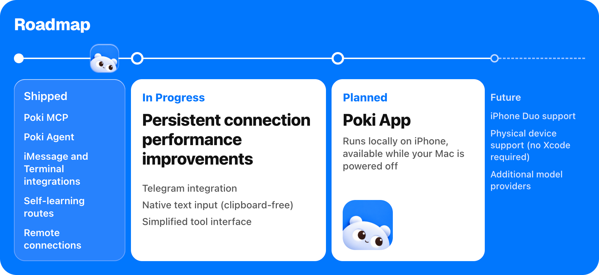

> これは macOS 向けの [Poki](https://github.com/JosssphZhou/poki) 本体の README です。このリポジトリの Windows 版については [README.md](README.md) をご覧ください。

<p align="center">
  
</p>

<h1 align="center">Poki は、あなたと同じように iPhone を使う</h1>

<p align="center">
  
</p>

<p align="center">
  <a href="README.poki.md">English</a> | <a href="README.poki.zh-CN.md">简体中文</a> | <a href="README.poki.zh-TW.md">繁體中文</a> | 日本語 | <a href="README.poki.ko.md">한국어</a> | <a href="README.poki.es.md">Español</a><br>
  <a href="https://poki.bot">poki.bot</a>
</p>

<!-- badges:start -->
<p align="center">
  <a href="LICENSE"></a>
  <a href="https://github.com/JosssphZhou/poki/stargazers"></a>
  <a href="https://github.com/JosssphZhou/poki/forks"></a>
  <a href="https://github.com/JosssphZhou/poki/issues"></a>
  <a href="https://github.com/JosssphZhou/poki/releases"></a>
  
</p>
<!-- badges:end -->

## クイックスタート

**エージェントにインストールを任せる。** 次の内容をエージェントに渡してください：

```text
https://github.com/JosssphZhou/poki を、ルートの AGENTS.md に従ってインストールしてください。MCP スキルも含めます。私の操作が必要なときは、その都度止まってください。
```

**Poki MCP。** Claude Code、Codex などの MCP クライアントをすでに使っていますか？ Poki MCP を接続すれば、ご自身のサブスクリプションをそのまま使えます。追加のモデルアカウントは不要です。

サーバーを起動し、動かしたままにします：

```sh
git clone https://github.com/JosssphZhou/poki.git
cd poki
./bin/setup
npm start
```

macOS 15 以降、完全版の Xcode、Rust、Node.js 24+、ffmpeg が必要です。`./bin/setup` が不足している依存関係をチェックします。初回ビルドには数分かかります。

### ビルド済み macOS arm64 パッケージ

リリースから `poki-v0.1.1-macos-arm64.tar.gz` をダウンロードして、次を実行します：

```sh
tar -xzf poki-v0.1.1-macos-arm64.tar.gz
cd poki-v0.1.1
npm ci --no-audit --no-fund
npm start
```

パッケージにはネイティブブリッジと idevice ツールが含まれています。Rust や `./bin/setup` は不要です。ただし、Apple Silicon の macOS、完全版の Xcode、Node.js 24+、Python 3、ffmpeg は必要です。MCP クライアントの登録と、オプションの Agent のインストールは下記のとおりです。

別のターミナルを同じディレクトリで開き、MCP サーバーを登録します：

```sh
claude mcp add --scope user poki-mcp -- node "$PWD/src/stdio.mjs"   # Claude Code
codex mcp add poki-mcp -- node "$PWD/src/stdio.mjs"                 # Codex
```

**Poki Agent。** Poki 単体のターミナルエージェントやメッセージングチャネルを使う場合は、`npm start` を動かしたまま、同じディレクトリで別のターミナルを開きます。エージェントをインストールし、そのコマンドをこのターミナルの PATH に追加して、サインインします：

```sh
npm ci --prefix agent
export PATH="$PWD/bin:$PATH"
poki login
poki status
```

Poki Agent は、デフォルトで GPT-6.1 Terra（`gpt-6.1-terra`）を推論強度 low で使用します。スマートフォンのタスクで私たちがテストした中で最も速い設定なので、そのまま使うことをおすすめします。モデルは `POKI_AGENT_MODEL` で変更できます。[Poki Agent の実行](agent/README.md)を参照してください。

実機の iPhone を使う場合は、先に USB で Mac とペアリングしてください。[実機 iPhone のセットアップ](docs/physical-iphone.md)を参照してください。

## タスクを試す

Poki Agent では、接続中の iPhone が 1 台なら自動で選択されます。複数台ある場合は `--device '<device UUID>'` を追加します。

```sh
node bin/call.mjs list_devices   # デバイスの UUID を確認
poki "Search esp32 in Chrome and summarize the top result"
```

> **注意：** Poki はあなたの実機 iPhone を操作します。メッセージの送信や支払いを頼めば、そのとおりに実行します。画面の内容は、設定したモデルサービスに送信されます。

使うほど速くなる：Poki Agent は過去のタスクを記憶し、繰り返し実行するときはより速く動きます。

**チャネル：** 許可済みのチャネルを設定したら、`poki imessage` または `poki telegram` で起動します。設定方法は [Poki Agent](agent/README.md) を参照してください。

**MCP クライアント：** Claude Code、Codex、および `mcpServers` JSON に対応したクライアント。

実機 iPhone のサポートは、中国語インターフェースの iPhone でのみ検証済みです。実機は縦向きのみ対応です。App コンテナのエクスポートと、設定アプリのサブページへの直接リンクは使えません。[検証結果と既知の制限](docs/verification.md)を参照してください。

## ドキュメント

| トピック | 参照先 |
| --- | --- |
| インストール、その他の MCP クライアント、トラブルシューティング | [インストールガイド](docs/install.md) |
| Poki Agent、モデル、iMessage、Telegram | [Poki Agent を実行する](agent/README.md) |
| MCP ツールリファレンス | [ツールの動作](docs/tools.md) |
| 環境変数とセッション | [設定](docs/configuration.md) |
| USB ペアリング、デベロッパモード、Wi-Fi | [実機 iPhone のセットアップ](docs/physical-iphone.md) |
| テスト結果、既知の制限、免責事項 | [検証](docs/verification.md) |
| ブリッジのアーキテクチャ | [ネイティブブリッジ](native/NATIVE.md)と[シミュレータアダプタ](native/simulator.md) |
| ロードマップ | [poki.bot](https://poki.bot) |

## ロードマップ

<p align="center">
  
</p>

- **リリース済み:** Poki MCP、Poki Agent、iMessage とターミナルの連携、自己学習ルート
- **開発中:** **リモート接続（同一 LAN 不要）**、Telegram 連携、ネイティブテキスト入力（クリップボード不使用）、常時接続のパフォーマンス改善、ツールインターフェースの簡素化
- **計画中:** Poki App：iPhone 上でローカル実行、Mac の電源がオフでも利用可能
- **将来の予定:** iPhone Duo のサポート、実機サポート（Xcode 不要）、対応モデルプロバイダーの追加

## Star History

<a href="https://www.star-history.com/?repos=JosssphZhou%2Fpoki&type=date&legend=top-left">
  <picture>
    <source media="(prefers-color-scheme: dark)" srcset="https://api.star-history.com/chart?repos=JosssphZhou/poki&type=date&theme=dark&legend=top-left">
    <source media="(prefers-color-scheme: light)" srcset="https://api.star-history.com/chart?repos=JosssphZhou/poki&type=date&legend=top-left">
    
  </picture>
</a>

## コントリビューター

<a href="https://github.com/JosssphZhou/poki/graphs/contributors">
  
</a>

## 免責事項

Poki は独立したオープンソースプロジェクトです。Apple、OpenAI、および Poki が操作するアプリやウェブサイトの開発元とは提携関係になく、それらの承認も受けていません。iPhone は Apple Inc. の商標です。

サードパーティのアプリやウェブサイトの自動操作は、それらの利用規約に違反する可能性があります。特定のサービスで Poki を使うかどうかは、ご自身で判断してください。お使いのデバイスとアカウント上で Poki が行うこと（送信したメッセージ、加えた変更、その結果生じたアカウントの制限を含む）については、ご自身の責任となります。

Poki は AGPL-3.0 ライセンスの定めるとおり、無保証かつ「現状のまま」提供されます。

解釈に相違がある場合は、英語版が優先されます。

## ライセンス

Poki は [AGPL-3.0-only ライセンス](LICENSE)のもとでオープンソースとして公開されています。

Copyright (c) 2026 Joseph Zhou and contributors. オープンソースの依存関係には、それぞれのライセンスが適用されます。[THIRD_PARTY_NOTICES.md](THIRD_PARTY_NOTICES.md) を参照してください。コントリビュートについては [CONTRIBUTING.md](CONTRIBUTING.md) をご覧ください。

## 謝辞

<p align="center">
  <br>
  <sub>オープンソースへの謝辞：<a href="https://github.com/earendil-works/pi">pi</a> | <a href="https://github.com/jkcoxson/idevice">idevice</a> | <a href="https://github.com/facebook/idb">idb</a> | <a href="https://github.com/BlueBubblesApp/bluebubbles-server">BlueBubbles</a> | <a href="https://github.com/NousResearch/hermes-agent">Hermes Agent</a> | <a href="https://github.com/modelcontextprotocol/typescript-sdk">MCP SDK</a> | <a href="https://github.com/lovell/sharp">sharp</a> | <a href="https://github.com/FFmpeg/FFmpeg">FFmpeg</a></sub>
</p>
