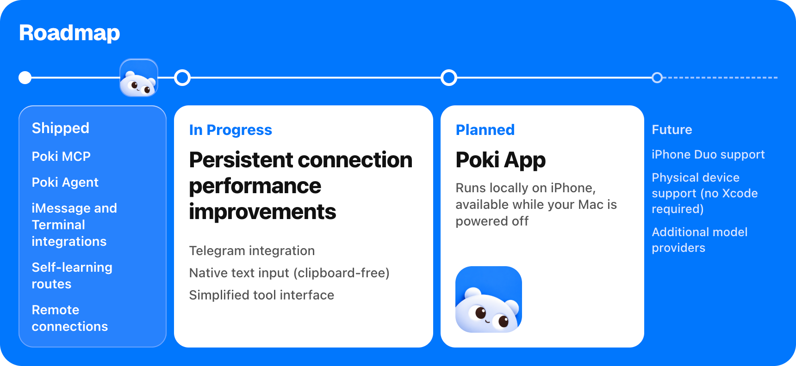

> 이 문서는 macOS용 [Poki](https://github.com/JosssphZhou/poki) 원본 README입니다. 이 저장소의 Windows 버전은 [README.md](README.md)를 참고하세요.

<p align="center">
  
</p>

<h1 align="center">Poki는 당신의 iPhone을 당신처럼 씁니다</h1>

<p align="center">
  
</p>

<p align="center">
  <a href="README.poki.md">English</a> | <a href="README.poki.zh-CN.md">简体中文</a> | <a href="README.poki.zh-TW.md">繁體中文</a> | <a href="README.poki.ja.md">日本語</a> | 한국어 | <a href="README.poki.es.md">Español</a><br>
  <a href="https://poki.bot">poki.bot</a>
</p>

<!-- badges:start -->
<p align="center">
  <a href="LICENSE"></a>
  <a href="https://github.com/JosssphZhou/poki/stargazers"></a>
  <a href="https://github.com/JosssphZhou/poki/forks"></a>
  <a href="https://github.com/JosssphZhou/poki/issues"></a>
  <a href="https://github.com/JosssphZhou/poki/releases"></a>
  
</p>
<!-- badges:end -->

## 빠른 시작

**에이전트에게 설치를 맡기세요.** 아래 내용을 복사해 에이전트에게 전달하세요:

```text
https://github.com/JosssphZhou/poki 를 루트의 AGENTS.md에 따라 MCP 스킬까지 포함해 설치해 줘. 내가 직접 해야 하는 단계가 나오면 그때마다 멈춰 줘.
```

**Poki MCP.** 이미 Claude Code, Codex 또는 다른 MCP 클라이언트를 쓰고 있나요? Poki MCP를 연결하면 사용 중인 구독을 그대로 쓸 수 있습니다. 별도의 모델 계정은 필요 없습니다.

서버를 시작하고 계속 실행해 두세요:

```sh
git clone https://github.com/JosssphZhou/poki.git
cd poki
./bin/setup
npm start
```

macOS 15 이상, 전체 버전 Xcode, Rust, Node.js 24+, ffmpeg가 필요합니다. `./bin/setup`이 누락된 의존성을 확인합니다. 첫 빌드에는 몇 분이 걸립니다.

### 사전 빌드된 macOS arm64 패키지

릴리스에서 `poki-v0.1.1-macos-arm64.tar.gz`를 내려받아 실행하세요:

```sh
tar -xzf poki-v0.1.1-macos-arm64.tar.gz
cd poki-v0.1.1
npm ci --no-audit --no-fund
npm start
```

패키지에는 네이티브 브리지와 idevice 도구가 포함되어 있습니다. Rust나 `./bin/setup`은 필요 없습니다. 다만 Apple Silicon macOS, 전체 버전 Xcode, Node.js 24+, Python 3, ffmpeg는 여전히 필요합니다. MCP 클라이언트 등록과 선택 사항인 Agent 설치는 아래를 참고하세요.

같은 디렉터리에서 다른 터미널을 열고 MCP 서버를 등록하세요:

```sh
claude mcp add --scope user poki-mcp -- node "$PWD/src/stdio.mjs"   # Claude Code
codex mcp add poki-mcp -- node "$PWD/src/stdio.mjs"                 # Codex
```

**Poki Agent.** Poki의 독립형 터미널 에이전트나 메시징 채널을 쓰려면 `npm start`를 계속 실행한 채 같은 디렉터리에서 다른 터미널을 여세요. 에이전트를 설치하고, 명령어를 이 터미널의 PATH에 추가한 뒤 로그인하세요:

```sh
npm ci --prefix agent
export PATH="$PWD/bin:$PATH"
poki login
poki status
```

Poki Agent는 기본적으로 GPT-6.1 Terra(`gpt-6.1-terra`)를 low 추론 강도로 사용합니다. 휴대폰 작업에서 저희가 테스트한 가장 빠른 설정이므로 그대로 사용하는 것을 권장합니다. `POKI_AGENT_MODEL`로 모델을 변경할 수 있습니다. [Poki Agent 실행](agent/README.md)을 참고하세요.

실제 iPhone을 쓰려면 먼저 USB로 Mac과 페어링하세요. [실제 iPhone 설정](docs/physical-iphone.md)을 참고하세요.

## 작업 실행해 보기

Poki Agent에서는 연결된 iPhone이 한 대면 자동으로 선택됩니다. 기기가 여러 대면 `--device '<device UUID>'`를 추가하세요.

```sh
node bin/call.mjs list_devices   # 기기 UUID 확인
poki "Search esp32 in Chrome and summarize the top result"
```

> **주의:** Poki는 실제 iPhone을 조작합니다. 메시지를 보내거나 결제하라고 하면 그대로 실행합니다. 화면 내용은 설정한 모델 서비스로 전송됩니다.

쓸수록 빨라집니다: Poki Agent는 지난 작업을 기억해 반복 실행할 때 더 빠르게 처리합니다.

**채널:** 승인된 채널을 설정한 뒤 `poki imessage` 또는 `poki telegram`으로 시작하세요. 설정 방법은 [Poki Agent](agent/README.md)를 참고하세요.

**MCP 클라이언트:** Claude Code, Codex, 그리고 `mcpServers` JSON을 지원하는 모든 클라이언트.

실제 iPhone 지원은 중국어 인터페이스를 쓰는 iPhone에서만 검증되었습니다. 실제 기기는 세로 방향만 지원합니다. 앱 컨테이너 내보내기와 설정 하위 페이지로 바로 가는 링크는 사용할 수 없습니다. [검증 결과와 알려진 제한](docs/verification.md)을 참고하세요.

## 문서

| 주제 | 문서 |
| --- | --- |
| 설치, 기타 MCP 클라이언트, 문제 해결 | [설치 가이드](docs/install.md) |
| Poki Agent, 모델, iMessage, Telegram | [Poki Agent 실행](agent/README.md) |
| MCP 도구 참조 | [도구 동작](docs/tools.md) |
| 환경 변수와 세션 | [구성](docs/configuration.md) |
| USB 페어링, 개발자 모드, Wi-Fi | [실제 iPhone 설정](docs/physical-iphone.md) |
| 테스트 결과, 알려진 제한, 면책 조항 | [검증](docs/verification.md) |
| 브리지 아키텍처 | [네이티브 브리지](native/NATIVE.md) 및 [시뮬레이터 어댑터](native/simulator.md) |
| 로드맵 | [poki.bot](https://poki.bot) |

## 로드맵

<p align="center">
  
</p>

- **출시됨:** Poki MCP, Poki Agent, iMessage 및 터미널 통합, 자가 학습 경로
- **개발 중:** **원격 연결(동일 LAN 불필요)**, Telegram 통합, 네이티브 텍스트 입력(클립보드 미사용), 지속 연결 성능 개선, 도구 인터페이스 간소화
- **계획됨:** Poki App: iPhone에서 로컬 실행, Mac이 꺼져 있어도 사용 가능
- **향후 계획:** iPhone Duo 지원, 실기기 지원(Xcode 불필요), 모델 제공업체 추가

## Star History

<a href="https://www.star-history.com/?repos=JosssphZhou%2Fpoki&type=date&legend=top-left">
  <picture>
    <source media="(prefers-color-scheme: dark)" srcset="https://api.star-history.com/chart?repos=JosssphZhou/poki&type=date&theme=dark&legend=top-left">
    <source media="(prefers-color-scheme: light)" srcset="https://api.star-history.com/chart?repos=JosssphZhou/poki&type=date&legend=top-left">
    
  </picture>
</a>

## 기여자

<a href="https://github.com/JosssphZhou/poki/graphs/contributors">
  
</a>

## 면책 조항

Poki는 독립적인 오픈소스 프로젝트입니다. Apple, OpenAI 또는 Poki가 조작하는 앱이나 웹사이트의 제작사와 제휴 관계가 없으며, 이들의 보증을 받지 않았습니다. iPhone은 Apple Inc.의 상표입니다.

타사 앱과 웹사이트를 자동으로 조작하면 해당 서비스 약관을 위반할 수 있습니다. 특정 서비스에서 Poki를 쓸지는 직접 판단하세요. 사용자의 기기와 계정에서 Poki가 하는 일(보낸 메시지, 변경한 내용, 그 결과로 생긴 계정 제한 포함)에 대한 책임은 사용자에게 있습니다.

Poki는 AGPL-3.0 라이선스에 명시된 대로 어떠한 보증도 없이 "있는 그대로" 제공됩니다.

해석에 차이가 있는 경우 영어판을 기준으로 합니다.

## 라이선스

Poki는 [AGPL-3.0-only 라이선스](LICENSE)에 따라 공개된 오픈소스입니다.

Copyright (c) 2026 Joseph Zhou and contributors. 오픈소스 의존성은 각자의 라이선스를 따릅니다. [THIRD_PARTY_NOTICES.md](THIRD_PARTY_NOTICES.md)를 참고하세요. 기여하려면 [CONTRIBUTING.md](CONTRIBUTING.md)를 읽어 보세요.

## 감사의 말

<p align="center">
  <br>
  <sub>오픈소스 감사의 말: <a href="https://github.com/earendil-works/pi">pi</a> | <a href="https://github.com/jkcoxson/idevice">idevice</a> | <a href="https://github.com/facebook/idb">idb</a> | <a href="https://github.com/BlueBubblesApp/bluebubbles-server">BlueBubbles</a> | <a href="https://github.com/NousResearch/hermes-agent">Hermes Agent</a> | <a href="https://github.com/modelcontextprotocol/typescript-sdk">MCP SDK</a> | <a href="https://github.com/lovell/sharp">sharp</a> | <a href="https://github.com/FFmpeg/FFmpeg">FFmpeg</a></sub>
</p>
