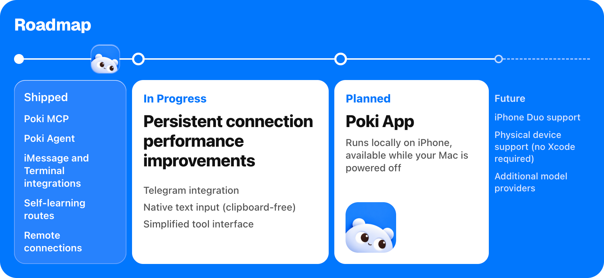

> 這是 [Poki](https://github.com/JosssphZhou/poki) 原專案的說明，適用於 macOS。本倉庫的 Windows 版請看 [README.zh-CN.md](README.zh-CN.md)（簡體中文）或 [README.md](README.md)。

<p align="center">
  
</p>

<h1 align="center">Poki 用你的 iPhone，就像你自己在用</h1>

<p align="center">
  
</p>

<p align="center">
  <a href="README.poki.md">English</a> | <a href="README.poki.zh-CN.md">简体中文</a> | 繁體中文 | <a href="README.poki.ja.md">日本語</a> | <a href="README.poki.ko.md">한국어</a> | <a href="README.poki.es.md">Español</a><br>
  <a href="https://poki.bot">poki.bot</a>
</p>

<!-- badges:start -->
<p align="center">
  <a href="LICENSE"></a>
  <a href="https://github.com/JosssphZhou/poki/stargazers"></a>
  <a href="https://github.com/JosssphZhou/poki/forks"></a>
  <a href="https://github.com/JosssphZhou/poki/issues"></a>
  <a href="https://github.com/JosssphZhou/poki/releases"></a>
  
</p>
<!-- badges:end -->

## 快速開始

**讓 agent 幫你安裝。** 把這段貼給你的 agent：

```text
依照 https://github.com/JosssphZhou/poki 根目錄的 AGENTS.md 安裝，包含 MCP 技能，需要我操作時就停下來。
```

**Poki MCP。** 已經在用 Claude Code、Codex 或其他 MCP 用戶端？接上 Poki MCP，用你自己的訂閱就好，不需要另外的模型帳號。

啟動伺服器並讓它持續執行：

```sh
git clone https://github.com/JosssphZhou/poki.git
cd poki
./bin/setup
npm start
```

需要 macOS 15 或以上版本、完整版 Xcode、Rust、Node.js 24+ 和 ffmpeg。`./bin/setup` 會檢查缺少的相依套件，第一次建置需要幾分鐘。

### 預先編譯的 macOS arm64 套件

從 Release 頁面下載 `poki-v0.1.1-macos-arm64.tar.gz`，然後執行：

```sh
tar -xzf poki-v0.1.1-macos-arm64.tar.gz
cd poki-v0.1.1
npm ci --no-audit --no-fund
npm start
```

套件內含原生橋接和 idevice 工具，不需要 Rust 或 `./bin/setup`。仍然需要 Apple Silicon 的 macOS、完整版 Xcode、Node.js 24+、Python 3 和 ffmpeg。MCP 用戶端的註冊和選用的 Agent 安裝，請參考下文。

在同一個目錄開另一個終端機，註冊 MCP 伺服器：

```sh
claude mcp add --scope user poki-mcp -- node "$PWD/src/stdio.mjs"   # Claude Code
codex mcp add poki-mcp -- node "$PWD/src/stdio.mjs"                 # Codex
```

**Poki Agent。** 想用 Poki 獨立的終端機 agent 或訊息管道的話，讓 `npm start` 繼續執行，在同一個目錄再開一個終端機。安裝 agent，把它的指令加進這個終端機的 PATH，然後登入：

```sh
npm ci --prefix agent
export PATH="$PWD/bin:$PATH"
poki login
poki status
```

Poki Agent 預設使用 GPT-6.1 Terra（`gpt-6.1-terra`），推理強度為 low。建議保留這項設定，它是我們在手機任務中測試過的最快設定。可透過 `POKI_AGENT_MODEL` 更換模型，詳見[執行 Poki Agent](agent/README.md)。

實體 iPhone 請先透過 USB 和 Mac 配對。詳見[實體 iPhone 設定](docs/physical-iphone.md)。

## 試跑一個任務

使用 Poki Agent 時，如果只連接一支 iPhone，會自動選取。連接多台裝置時，加上 `--device '<device UUID>'`。

```sh
node bin/call.mjs list_devices   # 查詢裝置 UUID
poki "Search esp32 in Chrome and summarize the top result"
```

> **注意：** Poki 操作的是你真實的 iPhone。如果你要它發訊息或付款，它就會照做。螢幕內容會傳送到你設定的模型服務。

越用越快：Poki Agent 會記住做過的任務，重複執行時速度更快。

**訊息管道：** 設定好已授權的管道後，用 `poki imessage` 或 `poki telegram` 啟動。設定方式請見 [Poki Agent](agent/README.md)。

**MCP 用戶端：** Claude Code、Codex，以及任何支援 `mcpServers` JSON 的用戶端。

實體 iPhone 的支援目前只在使用中文介面的 iPhone 上驗證過。實體裝置只支援直向。無法匯出 App 容器，也無法直接連到「設定」的子頁面。請見[驗證紀錄與已知限制](docs/verification.md)。

## 文件

| 主題 | 閱讀 |
| --- | --- |
| 安裝、其他 MCP 用戶端與疑難排解 | [安裝指南](docs/install.md) |
| Poki Agent、模型、iMessage 與 Telegram | [執行 Poki Agent](agent/README.md) |
| MCP 工具參考 | [工具行為](docs/tools.md) |
| 環境變數與工作階段 | [設定](docs/configuration.md) |
| USB 配對、開發者模式與 Wi-Fi | [實體 iPhone 設定](docs/physical-iphone.md) |
| 測試結果、已知限制與免責聲明 | [驗證](docs/verification.md) |
| 橋接架構 | [原生橋接](native/NATIVE.md)與[模擬器轉接層](native/simulator.md) |
| 路線圖 | [poki.bot](https://poki.bot) |

## 路線圖

<p align="center">
  
</p>

- **已發布:** Poki MCP、Poki Agent、iMessage 與終端機整合、自我學習路線
- **開發中:** **遠端連線（無需同一區域網路）**、Telegram 整合、原生文字輸入（不經剪貼簿）、長連線效能最佳化、簡化工具介面
- **計畫中:** Poki App：在 iPhone 本機執行，Mac 關機時可用
- **遠期規劃:** 支援 iPhone Duo、實機支援（無需安裝 Xcode）、更多模型供應商

## Star History

<a href="https://www.star-history.com/?repos=JosssphZhou%2Fpoki&type=date&legend=top-left">
  <picture>
    <source media="(prefers-color-scheme: dark)" srcset="https://api.star-history.com/chart?repos=JosssphZhou/poki&type=date&theme=dark&legend=top-left">
    <source media="(prefers-color-scheme: light)" srcset="https://api.star-history.com/chart?repos=JosssphZhou/poki&type=date&legend=top-left">
    
  </picture>
</a>

## 貢獻者

<a href="https://github.com/JosssphZhou/poki/graphs/contributors">
  
</a>

## 免責聲明

Poki 是獨立的開源專案，與 Apple、OpenAI 以及它所操作的任何 App 或網站的開發者都沒有關聯，也未獲得其背書。iPhone 是 Apple Inc. 的商標。

自動化操作第三方 App 和網站可能違反其服務條款。是否在特定服務上使用 Poki，請自行判斷。Poki 在你的裝置和帳號上做的事由你負責，包括它發送的訊息、做出的變更，以及因此造成的任何帳號限制。

Poki 依「現狀」提供，不附帶任何擔保，詳見 AGPL-3.0 授權條款。

如有歧義，以英文版為準。

## 授權條款

Poki 以 [AGPL-3.0-only 授權條款](LICENSE)開源。

Copyright (c) 2026 Joseph Zhou and contributors. 開源相依套件保留各自的授權條款，詳見 [THIRD_PARTY_NOTICES.md](THIRD_PARTY_NOTICES.md)。想參與貢獻，請見 [CONTRIBUTING.md](CONTRIBUTING.md)。

## 致謝

<p align="center">
  <br>
  <sub>開源致謝：<a href="https://github.com/earendil-works/pi">pi</a> | <a href="https://github.com/jkcoxson/idevice">idevice</a> | <a href="https://github.com/facebook/idb">idb</a> | <a href="https://github.com/BlueBubblesApp/bluebubbles-server">BlueBubbles</a> | <a href="https://github.com/NousResearch/hermes-agent">Hermes Agent</a> | <a href="https://github.com/modelcontextprotocol/typescript-sdk">MCP SDK</a> | <a href="https://github.com/lovell/sharp">sharp</a> | <a href="https://github.com/FFmpeg/FFmpeg">FFmpeg</a></sub>
</p>
