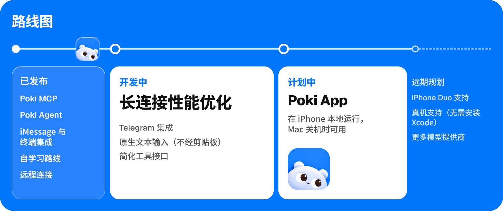

<p align="center">
  
</p>

<h1 align="center">Poki 像你一样使用你的 iPhone</h1>

<p align="center">
  
</p>

<p align="center">
  <a href="README.poki.md">English</a> | 简体中文 | <a href="README.zh-TW.md">繁體中文</a> | <a href="README.ja.md">日本語</a> | <a href="README.ko.md">한국어</a> | <a href="README.es.md">Español</a><br>
  <a href="https://poki.bot">poki.bot</a>
</p>

<!-- badges:start -->
<p align="center">
  <a href="LICENSE"></a>
  <a href="https://github.com/JosssphZhou/poki/stargazers"></a>
  <a href="https://github.com/JosssphZhou/poki/forks"></a>
  <a href="https://github.com/JosssphZhou/poki/issues"></a>
  <a href="https://github.com/JosssphZhou/poki/releases"></a>
  
</p>
<!-- badges:end -->

## 快速开始

**让 agent 帮你安装。** 把这段发给你的 agent：

```text
安装 https://github.com/JosssphZhou/poki，按根目录 AGENTS.md 配好 MCP 和使用技能，遇到必须由我操作的步骤就停下来告诉我。
```

**Poki MCP。** 已经在用 Claude Code、Codex 或其他 MCP 客户端？接入 Poki MCP，直接用你自己的订阅，不需要另外登录模型账号。

启动服务并保持运行：

```sh
git clone https://github.com/JosssphZhou/poki.git
cd poki
./bin/setup
npm start
```

需要 macOS 15 或更高版本、完整版 Xcode、Rust、Node.js 24+ 和 ffmpeg。`./bin/setup` 会检查缺失的依赖，首次构建需要几分钟。

### macOS arm64 预编译安装包

从版本发布页下载 `poki-v0.1.1-macos-arm64.tar.gz`，然后运行：

```sh
tar -xzf poki-v0.1.1-macos-arm64.tar.gz
cd poki-v0.1.1
npm ci --no-audit --no-fund
npm start
```

安装包包含原生桥接和 idevice 工具，无需安装 Rust 或运行 `./bin/setup`。仍需 Apple Silicon Mac、完整版 Xcode、Node.js 24+、Python 3 和 ffmpeg。MCP 客户端注册和可选 Agent 安装按下文操作。

在同一目录下打开另一个终端，注册 MCP 服务：

```sh
claude mcp add --scope user poki-mcp -- node "$PWD/src/stdio.mjs"   # Claude Code
codex mcp add poki-mcp -- node "$PWD/src/stdio.mjs"                 # Codex
```

**Poki Agent。** 如果要使用 Poki 独立终端智能体或消息渠道，保持 `npm start` 运行，在同一目录下打开另一个终端。安装智能体，将命令加入当前终端的路径，再登录模型账号：

```sh
npm ci --prefix agent
export PATH="$PWD/bin:$PATH"
poki login
poki status
```

Poki Agent 默认使用 GPT-6.1 Terra（`gpt-6.1-terra`），推理强度为 low。建议保留这一配置，它是我们在手机任务中测试过的最快配置。可通过 `POKI_AGENT_MODEL` 更换模型，详见[运行 Poki Agent](agent/README.md)。

如果连接 iPhone 真机，请先通过 USB 与 Mac 配对。详见[真机配置指南](docs/physical-iphone.md)。

## 试跑一个任务

Poki Agent 会自动选择唯一连接的 iPhone。连接多台设备时，加上 `--device '<device UUID>'` 指定设备。

```sh
node bin/call.mjs list_devices   # 查设备 UUID
poki "Search esp32 in Chrome and summarize the top result"
```

> **注意：** Poki 操作的是真实手机，如果你让它发消息或付款，它会直接执行；屏幕内容也会发送给你配置的模型服务。

越用越快：Poki Agent 会记住跑过的任务，再次执行同款任务时速度更快。

**消息渠道：** 配置获授权的渠道后，运行 `poki imessage` 或 `poki telegram`。详见[运行 Poki Agent](agent/README.md)。

**MCP 客户端：** Claude Code、Codex，以及任何支持 `mcpServers` JSON 配置的客户端。

目前仅在中文界面的 iPhone 上验证过真机支持。真机仅支持竖屏，不支持 App 容器导出和直接打开设置子页面。详见[验证记录与已知限制](docs/verification.md)。

## 文档

| 主题 | 文档 |
| --- | --- |
| 安装、其他 MCP 客户端与故障排查 | [安装指南](docs/install.md) |
| Poki Agent、模型、iMessage 与 Telegram | [运行 Poki Agent](agent/README.md) |
| MCP 工具说明 | [工具说明](docs/tools.md) |
| 环境变量与会话管理 | [配置说明](docs/configuration.md) |
| USB 配对、开发者模式与 Wi-Fi 连接 | [真机配置指南](docs/physical-iphone.md) |
| 测试结果、已知限制与免责声明 | [验证与限制](docs/verification.md) |
| 桥接层架构 | [原生桥接](native/NATIVE.md)与[模拟器适配](native/simulator.md) |
| 路线图 | [poki.bot](https://poki.bot) |

## 路线图

<p align="center">
  
</p>

## Star History

<a href="https://www.star-history.com/?repos=JosssphZhou%2Fpoki&type=date&legend=top-left">
  <picture>
    <source media="(prefers-color-scheme: dark)" srcset="https://api.star-history.com/chart?repos=JosssphZhou/poki&type=date&theme=dark&legend=top-left">
    <source media="(prefers-color-scheme: light)" srcset="https://api.star-history.com/chart?repos=JosssphZhou/poki&type=date&legend=top-left">
    
  </picture>
</a>

## 贡献者

<a href="https://github.com/JosssphZhou/poki/graphs/contributors">
  
</a>

## 免责声明

Poki 是独立的开源项目，与 Apple、OpenAI 以及它所操作的任何应用或网站的开发者均无关联，也未获得其认可。iPhone 是 Apple Inc. 的商标。

自动操作第三方应用和网站可能违反其服务条款，请自行判断是否在相应服务上使用 Poki。Poki 在你的设备和账号上执行的操作由你负责，包括它发送的消息、作出的更改，以及由此导致的账号限制。

Poki 按「原样」提供，不附带任何担保，具体以 AGPL-3.0 许可证为准。

如有歧义，以英文版为准。

## 开源许可

Poki 基于 [AGPL-3.0-only 许可证](LICENSE)开源。

Copyright (c) 2026 Joseph Zhou and contributors。开源依赖项保留各自的许可证，详见 [THIRD_PARTY_NOTICES.md](THIRD_PARTY_NOTICES.md)。如需参与贡献，请阅读 [CONTRIBUTING.md](CONTRIBUTING.md)。

## 致谢

<p align="center">
  <br>
  <sub>开源致谢：<a href="https://github.com/earendil-works/pi">pi</a> | <a href="https://github.com/jkcoxson/idevice">idevice</a> | <a href="https://github.com/facebook/idb">idb</a> | <a href="https://github.com/BlueBubblesApp/bluebubbles-server">BlueBubbles</a> | <a href="https://github.com/NousResearch/hermes-agent">Hermes Agent</a> | <a href="https://github.com/modelcontextprotocol/typescript-sdk">MCP SDK</a> | <a href="https://github.com/lovell/sharp">sharp</a> | <a href="https://github.com/FFmpeg/FFmpeg">FFmpeg</a></sub>
</p>
