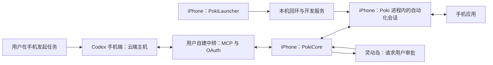

# Poki iPhone 独立运行：全链路操作文档

本文记录从应用签名到 Codex 手机端操作 iPhone 的完整配置过程。配置阶段可以使用 Mac；运行阶段由手机上的 Poki、用户自建中转和云端模型协作。Poki 在自己的进程里建立 XCTest 自动化会话来看屏和操作，默认只装 Poki 一个应用；旧的 Runner 路径要另装 Poki Runner，见第 3 节的可选步骤。

适用实现以本仓库 iOS 独立运行分支为准。本文依据 2026-11-07 的真机配置编写，已测范围见第 9 节。文件路径均相对仓库根目录，示例标识符需要替换为自己的值。

## 1. 运行结构与完成标准



手机向中转建立出站连接。中转转发 MCP 请求和回复，PokiCore 在手机上执行工具；PokiLauncher 挂载开发者磁盘映像，Poki 随后在自己的进程里打开自动化会话。远程任务选择云端主机，可避免依赖在线 Mac 执行代理循环。

验收分三层记录：

| 层次 | 必须看到的结果 |
| --- | --- |
| 配置完成 | 本机开发服务可达、手机配对成功、Poki 日志出现 `in-process session ready`、中转就绪、客户端完成认证 |
| 独立基本操作 | USB 已拔掉，从手机发起新云端任务，工具调用成功，目标应用实际打开或发生预期变化 |
| 完整真机验收 | 基本操作之外，完成时钟、备忘录、审批、后台、锁屏、重启、网络切换和失败恢复等约定项目 |

只完成第二层时，交回“独立基本操作已通过”，保留第三层的未测项。

## 2. 准备条件与连接选择

准备一台明确指定的 iPhone、可登录 Codex 的账号、自己的 Cloudflare 账户，以及可以为目标应用签名的 Apple 开发者团队。源码构建需要完整 Xcode、Rust、XcodeGen、Python 3 和 Node.js；版本要求以 `.github/workflows/ios-app.yml`、`ios-runner.yml` 和 `deploy/cf-relay/DEPLOY.md` 为准。

本轮使用 iOS 27.3，在手机上完成配对。其他系统版本按实际支持情况验证；必要时通过 Poki 导入自己的配对文件，记录使用的类型即可。

先选择连接方式：

| 方式 | 使用条件 | 手机配置 | 签名条件 |
| --- | --- | --- | --- |
| 内置本机连接 | 不需要同时保留其他 VPN，或用户明确选择切换 | 在 Poki 中启用，由用户通过系统验证 | Poki 与隧道扩展都具备 Network Extension 能力和匹配描述文件 |
| 复用现有 VPN | 当前 VPN 支持本机回环或等效 TCP 反射功能 | 保持原 VPN 连接，在 Poki 选择 External app | 可用完整版本，也可用不含隧道扩展的外部连接版本 |

付费开发者团队两种版本都能签。免费 Apple ID 的个人团队不能为 Network Extension 生成描述文件，只能签外部连接版本，本机连接由现有 VPN 或 LocalDevVPN 提供。两种账号对应的版本和需要注册的标识见 `native/ios-app/README.md` 的签名一节。

内置连接使用系统 VPN 配置。启用它可能断开其他 VPN；它不是免 VPN 配置方案。复用现有 VPN 时，Poki 自己的隧道保持关闭，使用现有隧道提供本机回环。

`10.7.0.1` 是本方案固定的手机内部地址，不是个人网络地址，也不是中转地址。内置实现只处理该地址的 IPv4 TCP，不添加互联网默认路由或 DNS 设置。

## 3. 构建、签名和安装

### 3.1 固定构建版本

先核对工作树、分支和实际提交。应用由 `.github/workflows/ios-app.yml` 构建；只有走旧的 Runner 路径时才需要 `.github/workflows/ios-runner.yml` 构建的 Runner。使用同一已核对版本对应的制品；本地未发布提交应本地构建，不能用其他版本的“最新制品”代替。

应用制品：

- `Poki-unsigned.ipa`：包含内置本机连接与隧道扩展。
- `Poki-external-unsigned.ipa`：不包含隧道扩展，依赖外部本机连接。
- `Poki-signing.zip`：用于重签名的具体 entitlement 文件，即系统签名权限配置。

Runner 制品（仅 Runner 路径）：`poki-runner-unsigned.ipa`。同一工作流另提供保留 XCTest 框架的版本，按安装方式选择。2026-11-07 的成功路径使用普通版本，由手机上的开发者磁盘映像提供系统测试框架；Runner 自身依赖的框架仍须保留并签名。

### 3.2 配置自己的应用标识

在 Apple Developer 的 [Account 入口](https://developer.apple.com/account/) 注册自有应用标识和共享组，再生成相应描述文件。标识关系示例：

| 对象 | 示例值 |
| --- | --- |
| Poki | `com.example.poki` |
| 实时活动扩展 | `com.example.poki.widgets` |
| 本机隧道扩展 | `com.example.poki.tunnel` |
| App Group，共享容器 | `group.com.example.poki` |
| Runner（仅 Runner 路径） | `com.example.poki.WebDriverAgentRunner.xctrunner` |

Poki 和实时活动扩展需要同一个有效 App Group。完整版本的 Poki 和隧道扩展还需要 `packet-tunnel-provider` 权限。通配描述文件不能代替这些能力的匹配描述文件；外部连接版本免去隧道权限，但仍需正确处理共享组。

如果 Apple 提示团队尚未接受新版开发者协议，账户持有人在上述入口完成后重试签名。系统解锁密码、账号验证和 VPN 配置验证由用户本人输入。

### 3.3 本地构建示例

先在终端私下设置 `TEAM_ID`、`APP_BUNDLE_ID`、`APP_GROUP` 和构建目录 `BUILD_DIR`。这些变量不写入共享报告。以下命令从仓库根目录执行：

```sh
native/launcher/fetch-idevice.sh
rustup target add aarch64-apple-ios
cargo build --release --locked --target aarch64-apple-ios \
  --manifest-path native/launcher/Cargo.toml
native/ios-app/scripts/make-assets.sh
xcodegen generate --spec native/ios-app/project.yml

xcodebuild build \
  -project native/ios-app/Poki.xcodeproj -scheme Poki \
  -configuration Release -destination generic/platform=iOS \
  -derivedDataPath "$BUILD_DIR" ARCHS=arm64 \
  DEVELOPMENT_TEAM="$TEAM_ID" CODE_SIGN_STYLE=Automatic \
  POKI_BUNDLE_ID="$APP_BUNDLE_ID" POKI_APP_GROUP="$APP_GROUP"
```

团队、证书和描述文件须事先可用。外部连接版本将项目生成规格换为 `project-external.yml`，项目换为 `PokiExternal.xcodeproj`，scheme 仍为 `Poki`。

重签名未签名制品时，用制品内提供的签名文件。源码构建后也可以按实际产物导出：

```sh
python3 native/ios-app/scripts/export-signing.py \
  "$APP_PATH" local "$SIGNING_OUTPUT_DIR"
```

外部连接版本将 `local` 换为 `external`。导出工具从已构建的 Info.plist 读取 App Group；不要将尚未解析的 `$(POKI_APP_GROUP)` 模板文字当成最终组名。重新生成 Xcode 项目后应重新检查签名输入。

### 3.4 检查嵌套签名

检查主应用、扩展、动态库及框架中的每个 Mach-O 可执行文件。走 Runner 路径时，Poki 和 Runner 使用同一签名工具、团队和 Apple ID，Runner 的测试包也要逐个检查。

Runner 内的依赖顺序包括：

```text
PokiRunner.app/
  Frameworks/libPokiRunnerHost.dylib
  PlugIns/WebDriverAgentRunner.xctest/
    Frameworks/WebDriverAgentLib.framework/
```

重签名按内部依赖到外层容器的顺序进行。先签框架和动态库，再签测试包及扩展，最后签主应用，并分别使用适合该对象的权限配置和描述文件。

外层 `codesign --verify --deep --strict` 通过仍不足以证明全部嵌套二进制已签名。本轮曾遇到内层框架未签名，但外层检查通过；安装成功后启动却返回 `NSError 103`。对每个 Mach-O 分别运行 `codesign --verify --strict`，并用 `codesign -dv` 核对 TeamIdentifier，才能排除这类漏签。

### 3.5 安装并完成系统准备

通过既定签名安装工具、Xcode 设备窗口或本机已支持的安装工具安装 Poki。若使用当前 Xcode 的命令行入口：

```sh
xcrun devicectl device install app --device "$TEST_UDID" "$APP_PATH"
```

走 Runner 路径时，再用同一命令安装 `$RUNNER_PATH`，并用启动参数 `-automationPath runner` 启动 Poki（例如 `xcrun devicectl device process launch` 带这个参数）；这个参数只对这一次启动有效。

`TEST_UDID` 必须来自当前任务指定的设备。先解锁，并由用户完成系统要求的信任确认。检查实际安装结果，不能仅凭安装器退出码判断。

在手机中完成：

1. 设置 → 隐私与安全性 → 开发者模式；按系统要求重启并确认。
2. 设置 → 开发者 → 启用 UI 自动化。
3. 按系统实际要求处理开发者信任。某些团队签名没有“信任开发者”条目，不应将条目缺失直接判为错误。
4. 打开 Poki。自动化会话由 Poki 在自己的进程里打开。走 Runner 路径时，手动打开 Runner 核对其引导画面，然后回到 Poki。

只装 Poki、从没开过开发者模式的手机，第 1 步的菜单可能不出现：以前是装上 Runner 后才出现的。遇到时记录手机型号和系统版本，交回派任务的人，不另装 Runner 绕过。

完成标准：Poki 已安装，签名完整，系统准备完成。Runner 路径另需 Runner 已安装、Poki 能识别它。保留其他已安装自动化应用及其状态。

## 4. 本机连接、手机配对和后台权限

### 4.1 内置本机连接

在 Poki 的 Setup → Connect to this iPhone 选择 Built-in，点击 Enable local connection。用户完成系统“添加 VPN 配置”验证后，等待 Poki 的开发服务检查通过。

然后打开普通网页验证网络仍可用。保存了 VPN 配置或显示 Connected 都不能代替开发服务检查。断开、重连和重启恢复属于不同验证项目，分别记录。

### 4.2 复用现有 VPN

在现有 VPN 的 TUN 或等效设置中找到“回环地址 / Loopback address”，实际输入并保存 `10.7.0.1`，保持现有 VPN 连接。若该软件使用路由加反射规则，则按其功能说明配置同一内部地址。

注意灰色示例值可能只是占位文字。保存后重新打开该设置，核对真实值。保持已有节点、订阅和互联网路由设置。

回到 Poki，选择 External app，点击 Use the current VPN。确认 Poki 自己的隧道关闭，开发服务检查通过，再打开原来依赖现有网络设置的网页验证可用。

当前 VPN 没有上述能力时，这条配置路径不能成立。改选另一条已授权路径，或将兼容性限制交回；不要静默替换用户的网络配置。

### 4.3 在手机上配对

本机连接检查通过后：

1. 在 Poki 开始配对，保持应用会话和配对保活运行。
2. 打开设置 → 通用 → VPN 与设备管理，进入系统显示的附近电脑配对入口，选中 Poki。
3. 用户在手机上查看 Poki 生成的六位配对码，再回到系统输入页输入。配对码不发送到聊天中。
4. 等待 Poki 显示配对完成。确认记录保存在应用容器中，只记录存在及解析成功，不输出文件内容。

灵动岛中的配对码显示应单独验收。本轮实际从 Poki 应用查看配对码后完成配对；灵动岛曾保留旧引导文字，不能算配对码在灵动岛展示通过。

如果设置中找不到 Poki，检查当前版本是否包含切换到设置后的配对保活修复。单纯重复进入配对页不会解决应用在后台停止广播的问题。确需重新配对时，先明确正在替换的是本应用记录。

### 4.4 启动会话

按 Poki 的 Setup 页面完成后台位置权限、通知和实时活动等系统提示。位置授权页可能含地图，演示素材避开此页面。保持 Poki 在后台，不从多任务切换器划掉它。

准备开发者磁盘映像后开启 Poki。启动器经 connecting → pairing → running，重启后的首次运行可能还有 mounting_ddi；它只挂载映像，不经过 launching。随后 Poki 打开进程内会话，首次打开时 iOS 可能要求用户输入设备密码以允许自动化。完成标准是 Poki 日志出现 `in-process session ready`；出现 `in-process session not ready` 时，智能体的调用会立即收到失败原因，下一次调用、Poki 回到前台或智能体重新连接时 Poki 会再试。

进程内会话一直开到 Poki 退出，不按空闲停止，「Automation Running」横幅也一直显示。锁屏、切后台可能让会话失效；按设计下一次调用由 Poki 重新建立，这一条还没有真机验证。后台存活检查时记录失效后第一次调用的结果和用时。

走 Runner 路径时，状态还会经过 launching，Poki 可能按空闲设置主动停止 Runner。出现休眠状态不等于会话失效；用新工具调用确认能否唤醒，并记录当前空闲超时。

## 5. 部署自己的中转

在已获授权的 Cloudflare 账户中创建独立 Worker，避免覆盖其他任务的实例。部署实现来自 `deploy/cf-relay/`。没有登录时，先完成该账户的正常浏览器登录。

部署命令会输出真实服务地址，因此将输出保存到仓库外的私有日志。`RELAY_NAME` 是自己选定的 Worker 名，和 `TEAM_ID` 等变量一样在终端私下设置：

```sh
umask 077
relay_task_dir=$(mktemp -d)
deploy/cf-relay/deploy.sh --name "$RELAY_NAME" \
  > "$relay_task_dir/deploy.log" 2>&1
```

本机私下查看部署结果，将自己的 HTTPS 服务地址填到 Poki 的 Connect → Relay address。实际地址和日志不粘贴到 issue、Skill、演示或公开提交。

部署脚本首次生成 `TOKEN_SECRET`，后续部署复用它。保留已有密钥，避免让已连接客户端全部失效。生产观测和日志选项按部署说明保持关闭。

确认 Poki 的中转状态 ready / Online 后，为 Codex 创建单独连接。生成的连接器网址同时包含授权凭据，属于秘密。它应直接进入客户端私有设置中的 Server URL 字段。

认证流程是 MCP Streamable HTTP 与 OAuth 注册、PKCE 授权和令牌交换。使用默认认证设置即可。当前实现拥有连接器网址即可申请授权，网址必须按密钥保管；它不是需要额外公开的产品链接。

完成标准：真实手机保持在线，客户端完成认证，并通过这条中转收到手机回复。部署 dry-run、模拟手机检查或地址能访问，都不等于真机链路通过。

## 6. 接入 Codex 手机端的云端任务

本轮入口是 ChatGPT iOS 应用侧栏中的 Codex。不同客户端版本的名称可能不同，以当前实际界面为准。

### 6.1 创建个人 MCP 插件

本轮使用浏览器完成一次插件配置，随后在手机上调用：

1. 用与手机相同的账号打开 [插件目录](https://chatgpt.com/plugins)。
2. 点击添加 → 添加自定义 MCP 服务器。
3. 填写名称，例如 `Poki Phone`；Server URL 填入刚生成的私有连接器网址，身份验证选 OAuth。
4. 核对目标是自己刚部署的服务，完成自定义服务器提示，点击创建为插件和连接。
5. 在个人目录及插件设置中确认已添加、已连接。保持个人访问范围，无需公开发布。

配置网页不录屏，不输出包含表单值的完整页面快照。检查结果只保留插件名称、连接状态和工具名称。

### 6.2 在手机发起云端任务

1. 打开手机 Codex，选择云端主机。本轮使用 Default environment。
2. 在输入框通过附件 → 插件，或输入 `@`，选择刚创建的插件。
3. 新增插件未出现时，先检查手机“设置 → 插件”中的已添加列表，确认账号相同；必要时重新打开客户端以刷新列表。
4. 按当前任务要求选择可用模型、推理强度和速度，不用电脑远程主机替代云端主机。
5. 发出最小操作任务，例如“通过此插件打开时钟，读取当前页面后停止”。

核对协议 `tools/list` 是否包含 `look`、`do`、`status`，再核对客户端实际暴露的工具。插件界面的写操作分组可能只列 `do`，不能仅凭这张卡片推断整个协议工具列表。

操作示例属于真实手机输入，先确认任务允许操作目标应用：

```json
{"actions":[{"launch":"com.apple.mobiletimer"}]}
```

这是 `do` 的参数，返回包含动作结果及一次屏幕读取。`look` 是独立看屏工具，`status` 读取自动化会话和中转状态（输出里仍叫 runner）。客户端若只暴露部分工具，按实际能力验证并记录，不能把私有测试脚本的调用冒充客户端调用。

完成标准：手机任务页显示云端主机，任务记录出现实际插件工具调用，手机产生对应结果。

## 7. 拔线验证与完整验收

先完成上述配置，再进行独立运行检查：

1. 由用户拔掉 USB，明确记录拔线情况、iOS 版本和 Wi-Fi 或蜂窝网络。
2. 关闭与此次验证无关的电脑端手机控制入口，保留用户手机上的 Poki 会话。运行任务使用云端主机。
3. 从手机发起一项新任务，打开测试应用并读取页面。记录第一条到最后一条工具调用的时间，以及用户看到的实际结果。
4. 分别核对屏幕读取、打开应用和界面内点击。打开应用成功不能替代界面内点击验证。

完整验收以仓库 `docs/device-test-checklist.md` 第 0 至 6 节为准。将其中客户端名称适配为当前实际使用的 Codex，并保留以下独立项目：

| 项目 | 验证方式 |
| --- | --- |
| 时钟与备忘录 | 时钟添加一座城市；备忘录创建专用测试笔记，记录首末调用和结果 |
| 后台 | Poki 后台五分钟，核对会话仍在或失效后能重建；Runner 路径结合空闲超时判断保活和唤醒 |
| 锁屏与重启 | 锁屏两分钟后解锁；重启后按系统要求恢复，记录恢复时间 |
| 网络 | Wi-Fi 断开与恢复、蜂窝运行、首次挂载映像分别验证 |
| 失败恢复 | 进程内会话失效（Runner 路径为 Runner 被关闭）、执行中断及手机离线时，核对错误含义、返回时限和下一次读取 |
| 审批 | 专用测试照片上的删除操作、允许、拒绝、超时后重试、重复动作、阻止代理自批、密码输入隐藏 |
| 实时活动 | 当前工具、结果缩略图、后台显示和结束状态 |

审批检查使用专用测试资产，并按当次授权执行。危险动作先停在审批状态，由用户本人在灵动岛批准；代理不得点击自己的批准按钮。记录首次请求在等待期间的行为，以及超过 20 秒后的同动作重试行为，按实际结果判定。

若要交付演示视频，删除审批段单独录制。录制从普通测试页面开始，避开连接器网址、账户和网络设置页面。脱敏检查通过后才能分享。没有真实录制的素材，交回时写“未录制”。

## 8. 实际遇到的故障与处理

下表是 2026-11-07 在 Runner 路径上遇到的故障，涉及 Runner 的几行只适用于 Runner 路径。

| 现象 | 检查与处理 | 确认修复的依据 |
| --- | --- | --- |
| Apple 拒绝签名，要求接受协议 | 账户持有人在开发者账户入口处理，再重试 | 实际签名和安装成功 |
| App Group 权限不匹配 | 自有组关联应用和实时活动扩展；从构建产物导出具体签名配置 | 产物中的组名一致，签名权限和描述文件匹配 |
| 显示 VPN 已连接，开发服务仍不通 | 检查回环真实值、选择方式和开发服务探测结果 | Poki 连接检查通过，网页仍可用 |
| 切到设置后找不到 Poki 配对项 | 配对过程维持后台保活与广播，使用含修复的版本 | 系统配对列表实际出现 Poki，并完成配对 |
| 配对码输入页无法截图或读取 | 用户切到 Poki 查看，在系统界面手动输入 | 配对完成，应用容器中存在有效记录 |
| 安装成功但 Runner 返回 NSError 103 | 检查每个嵌套 Mach-O，尤其测试包里的依赖框架 | 内层签名完整，真实启动进入 running |
| 客户端插件刚创建却搜不到 | 核对账号及手机已添加列表，重新打开客户端 | 手机能选择该插件，云端产生实际工具调用 |
| Runner 空闲后显示休眠 | 核对空闲配置，通过新调用测试唤醒 | 新调用进入 running 并返回屏幕 |

错误提示中的“开发者不受信任”不能单独证明根因。本轮 Runner 的实际问题是操作时漏签嵌套框架，修正的是本地签名制品，不是仓库代码。

已知边界：Runner 路径下 Runner 的 8100 端口对局域网开放。中转上的认证和审批不能代替对直接访问该端口的控制，走 Runner 路径时这个边界应随交回保留。进程内路径不开这个端口。

## 9. 2026-11-07 的实际验证范围

实际安装代码：`8bcd387`，基于原 iOS 应用段 `e806589`，包含本机连接、可配置签名组、复用现有 VPN 和配对保活修复。下面的结果绑定这个安装版本，走的是 Poki 加 Runner 两个应用的 Runner 路径；进程内路径没有包含在内，须另行验收。

| 结果 | 本轮证据 |
| --- | --- |
| 同团队签名与安装 | Poki 和 Runner 已安装，嵌套签名修正后 Runner 能运行 |
| 本机连接 | 内置连接曾通过开发服务检查；独立运行时复用现有 VPN，网页可用 |
| 手机配对 | 设置中出现 Poki，用户在手机输入配对码，Setup 六项完成，配对文件有效 |
| 启动 | Runner 从连接到 running 约 17.8 秒；没有覆盖重启后的首次映像挂载 |
| 自建中转 | 在用户自己的账户部署，真实手机在线，OAuth、初始化和工具发现成功 |
| 看屏 | 拔线前一次请求约 1.49 秒，返回截图和 14 个元素；拔线后一次读取约 2.22 秒，返回截图和 90 个元素 |
| Codex 手机端 | 云端任务实际调用 `do` 打开微信，工具调用约 8.58 秒，用户确认实际打开 |
| 独立条件 | 用户明确确认执行时 USB 已拔掉，使用 Wi-Fi；任务记录主机为云端 |

打开微信是此次已完成的验证任务；它不包含发送消息或读取聊天内容的授权。文档复现可以使用时钟等普通测试应用。

未完成：时钟添加城市、备忘录任务、界面内点击的独立验收、灵动岛审批全部分支、后台五分钟、锁屏两分钟、重启恢复、蜂窝与网络切换、执行中断、真机离线，以及完整实时活动状态。配对码在灵动岛的展示存在待复核现象。完整原清单尚不能判定通过。

本轮没有录制完整演示视频，也没有单独的审批视频。已有截图和调用记录不能标为录屏。

## 10. 维护与交回

Skill 的仓库来源是 `skills/poki-standalone/`。安装时复制整个目录到当前客户端的技能目录，保留 `references/operations.md`；更新已有安装前检查本地修改。团队共享目录由当前环境约定，Codex 的个人技能入口通常在 `~/.codex/skills/`。

交回给用户的材料包括：实际安装提交、文档提交、原始基点、每项结果和网络条件、故障与修复、脱敏证据，以及未测项。源码修复与本地制品修正分开记录。当前分支与后续审查分支的差异在合并时处理；不得把另一个分支的审查结论自动套用到此分支。

只在用户要求重新配置或回收时处理连接。删除本次客户端连接会撤销对应访问；停止 Poki 会话会结束当前服务；内置隧道的断开只作用于 Poki 自己的配置。其余网络配置按原有状态保留。

参考入口：

- 仓库实现：`native/ios-app/`、`native/ios/PokiCore/`、`native/ios/PokiLoopback/`、`native/launcher/`。
- 构建入口：`.github/workflows/ios-app.yml`；Runner 路径另有 `.github/workflows/ios-runner.yml`。
- 中转部署：`deploy/cf-relay/deploy.sh`、`deploy/cf-relay/DEPLOY.md`。
- 完整检查：`docs/device-test-checklist.md`。
- OpenAI 官方说明：[自定义 MCP 插件配置](https://developers.openai.com/plugins/quickstart)、[云端环境与手机入口](https://learn.chatgpt.com/docs/environments/cloud-environments)、[MCP 接入方式](https://learn.chatgpt.com/docs/extend/mcp)。
